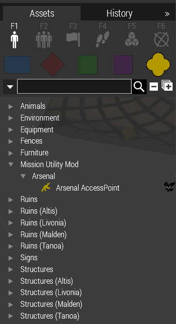
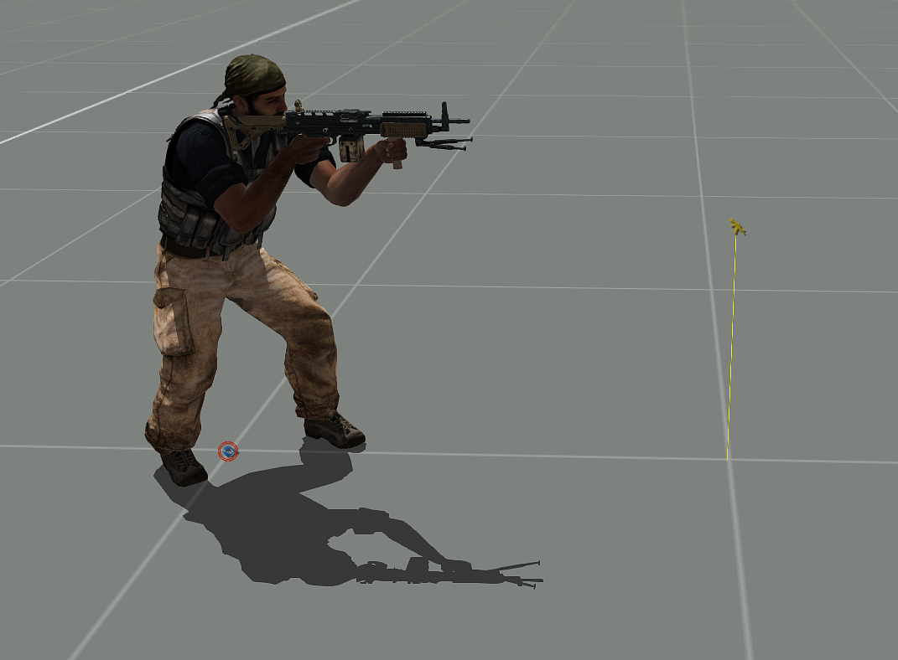

# Arsenal - Framework for ACE Arsenal

The Arsenal Framework for ACE Arsenal provides dedicated kits based on the players role and other conditions.

This is primarily made for reusability across multiple missions - so campaigns or missions with a repeating modset and player loadouts, as well as "Zeus Templates".

It allows mission makers to create "kits" (basically a list of individual items) and make them available via an whitelisted ACE Arsenal.
These Kits can be made conditional, meaning they can be assigned to certain roles or player ID's or other code conditions.

Example mission folder can be found [here](https://github.com/CVO-Org/Zorns-Mission-Utility-Mod/blob/main/.hemtt/missions/arsenal.VR).

## Summary
- Supports Kits limited for certain "Roles"
- Supports Kits based on players Steam64 IDs
- Auto Assigns "Roles" based on Traits
- Auto Assigns "Traits" based on Roles
- Default Kits, Auto Roles and Auto Traits can be disabled via CBA Settings or a 3den Module

### How to Implement
   1. Load Zorns Mission Utility Mod
   2. Create `mum_arsenal.hpp` and include in the mission's `description.ext`
   3. Define Arsenal Objects, either via editor layer name or objectVariable or both in `mum_arsenal.hpp`
   4. Define Units Roles.
   5. Define kits in `mum_arsenal.hpp`.

## Roles

### What is a role?
Roles are simple "tags" defined by the mission makers via a function call on the unit.

Roles are case-insensitive and will be converted to lowercase ANSI characters.
Like classnames, roles must not contain spaces.


### Auto Roles - Automatic Role Assignement

Certain roles will be automatically assigned, based on ace or vanilla traits.

| Condition                             | Mum Arsenal Role (String) |
| ------------------------------------- | ------------------------- |
| ACE Medical Trait = 1                 | `"Medic"`                 |
| ACE Medical Trait = 2                 | `"Doctor"`                |
| ACE Engineer Trait = 1                | `"Engineer"`              |
| ACE Engineer Trait = 2                | `"AdvEngineer"`           |
| Vanilla Trait `"medic"`               | `"Medic"`                 |
| Vanilla Trait `"engineer"`            | `"Engineer"`              |
| Vanilla Trait `"explosiveSpecialist"` | `"explosiveSpecialist"`   |
| Vanilla Trait `"UAVHacker"`           | `"EWSpecialist"`          |

### Auto Traits - Automatic Trait Assignement
Certain Traits will be automatically assigned, based on the Arsenal Roles.

| Condition                                | Vanilla Trait           |
| ---------------------------------------- | ----------------------- |
| Mum Arsenal Role `"explosiveSpecialist"` | `"explosiveSpecialist"` |
| Mum Arsenal Role `"EWSpecialist"`        | EW Specialist (`"UAVHacker"`) |

### How to Assign an Arsenal Role

#### 1. 3den Editor Attribute


One or more Roles can be assigned like this.
Example: `Marksman` or `firstRole, secondRole`.

#### 2. Script
Roles are added to a unit with `mum_arsenal_fnc_addUnitRoles`.
This can be done either via a units Init Field in the 3den Editor or other script application.

Examples for the units init field:
- `[ this, "someRole" ] call mum_arsenal_fnc_addUnitRoles;`
- `[ this, ["someRole"] ] call mum_arsenal_fnc_addUnitRoles;`
- `[ this, ["someRole", "anotherRole"] ] call mum_arsenal_fnc_addUnitRoles;`

More Infos [here](functions/roles/fn_addUnitRoles.sqf)


## Kits

### What is a kit?
A Kit is a collection of items made available in the Arsenal.
Optional requirements can be attached to a kit. For example: Roles, Addon dependency or a condition code.
These requirements will be evaluated every time a player opens the MUM Arsenal.

### Example Kit Configurations

The following kits can be referenced as examples on how to format a kit.

Further, the following kits are **hardcoded** through the mod itself. Except for the personal kits, they can be disabled through CBA Settings or the "Disable Defaults" module, see [Disable Defaults](#disable-defaults).

- [Base Kits - Available for Everyone](mum_arsenal_kits_base.hpp)
- [Role Kits - Available for certain Roles](mum_arsenal_kits_role.hpp)
- [Personal Kits - Available for individual Players](mum_arsenal_kits_personal.hpp)


### Config Properties
#### General Attributes
| Attribute Name        | DataType           | Description                                                                                                 |
| :-------------------- | ------------------ | ----------------------------------------------------------------------------------------------------------- |
| editor_layer_name     | <STRING>           | Provide an Eden Editor layer name.<br> All Objects inside this Layer will be made into MUM Arsenal Objects. |
| object_variable_names | <ARRAY of STRINGS> | Provide the variable names of individual objects to make them into MUM Arsenal Objects.                     |

 #### Kit Attributes:

| Attribute Name   | DataType                     | Description                                               | Default              |
| :--------------- | ---------------------------- | --------------------------------------------------------- | -------------------- |
| addon_dependency | <STRING>                     | Name of an Addon - Check if  loaded.                      | `""` Skip check.     |
| sides            | <STRING or ARRAY of STRINGS> | String of Side - `"WEST"`, `"EAST"`, `"GUER"`, `"CIV"`    | `[]` Applied to all. |
| role             | <STRING>                     | Name/Identifier of the Role. case-insensitive. ANSI only. | `""` Applied to all. |
| id64             | <STRING>                     | steamID64 (getPlayerUID or https://steamid.io/)           | `""` Applied to all. |
| condition        | <STRING>                     | Code as String - needs to return boolean. Must not be empty. | `"true"`          |
| code             | <STRING>                     | Code as String - needs to return array of classnames.     | `""` Skipped.        |
| items            | <CLASS with SUBCLASSES>      | subclasses will get added as item classnames.             |                      |

Note: parameters for the condition and code are `params ["_unit", "_items"];`.

### Kits via Script
Kits can also be added via script with [`mum_arsenal_fnc_createKit`](functions/kit/fn_createKit.sqf).
Kits are stored locally, so this needs to run on every client, for example in `initPlayerLocal.sqf`.

```sqf
// [items, condition, sides, role, id64, addon_dependency, code, key]
[["ACE_EarPlugs"]] call mum_arsenal_fnc_createKit;
[["ACE_M26_Clacker"], {true}, ["WEST"], "explosiveSpecialist", "", "", {}, "myClackerKit"] call mum_arsenal_fnc_createKit;
```

### Ad hoc Items
For items that should be available to everyone without defining a kit, add their classnames to `mum_arsenal_api`.
They are added every time the MUM Arsenal is opened. The variable is read locally, so broadcast it if needed.

```sqf
mum_arsenal_api = ["ACE_Banana", "ACE_Can_Franta"];
publicVariable "mum_arsenal_api";
```


### Disable Defaults

The default kits, auto roles and auto traits that come with the mod can be disabled in three ways.
An entry is disabled as soon as one of these ways disables it, so one way can never re-enable what another one disabled.
Personal kits (kits with an `id64`) can not be disabled.

#### 1. Individually via CBA Settings


#### 2. Individually via the "Disable Defaults" module
Place the module `Systems (F5) > Modules > MUM - Arsenal Modules > Disable Defaults` and uncheck the entries you want to disable.
The module lists every default kit, auto role and auto trait of the loaded mods, so it also gives a quick overview of what is available.
The module is 3DEN only. Multiple modules add up.

#### 3. All kits at once via description.ext
```cpp
// Inside description.ext
mum_arsenal_ignoreBaseKits = 1;
mum_arsenal_ignoreBaseRoleKits = 1;
```

### Arsenal Access Point

For Missionmakers who would like to do a more decorative setup who seek to be able to have an "offset" arsenal interaction node, an invisible object has been created which will open the arsenal menu.



